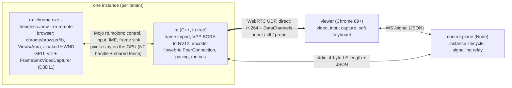

# Architecture overview

**One sentence:** a small-patch Chrome `--headless=new` (product PRTS, web identity Google Chrome) keeps popups inside its own Aura root and
exports each browser window as a D3D11 shared texture through Viz's `FrameSinkVideoCapturer`; the in-tree C++ endpoint `re` (libwebrtc +
oneVPL) encodes that texture to H.264 and sends it to the user over WebRTC; user input returns as `ui::Event`s injected into the matching
`WindowTreeHost` with `aura::EventInjector`; browser and `re` talk Mojo. Requirements: [brief](brief.md). Why each choice: [decisions](decisions.md).

## Components and processes

- Instance = one rb process tree + one profile + **one `re` process**: fault isolation (an encoder/driver crash hits one tenant), per-tenant Job
  Object accounting later ([isolation](isolation.md)), one-to-one Mojo/handle relations. Cost: one D3D11 device and VPL session per instance.
- The control-plane starts `re` (`ENDPOINT_PATH`); `re` starts rb. After WebRTC is up, media and input go `re` <-> viewer directly.
- The control-plane persists named instances and profiles under `CP_DATA_DIR` (default `.data`), autostarts selected instances, and
  restarts each independently with backoff. Its [REST API](control-plane.md#instances-and-profiles) manages lifecycle and job limits;
  clients select `?instance=<id>` (`default` preserves the original endpoint URL). `GET /api/instances` supplies metadata/status for
  the separate viewer settings redesign.
- Component docs: [browser](browser.md), [re](re.md), [control-plane](control-plane.md), [viewer](viewer.md), [protocol](protocol.md),
  [video-pipeline](video-pipeline.md), [tools](tools.md).

## Frame path (one frame)
1. Page or browser UI (including in-root popups) changes -> compositor frame -> Viz aggregates at the BeginFrame deadline.
2. The root sink has damage -> the capturer samples; `CopyOutputRequest` runs in the same `DrawAndSwap` into a D3D11 pool texture; Viz signals a
   shared fence and delivers `{NT handle, token, fence value, LUID}` (default) or a keyed-mutex texture (fallback) over Mojo.
3. `re` opens the cached texture, queues a GPU wait on the fence, runs the video processor BGRA->NV12 into the encoder surface, returns the buffer.
4. The encoder (oneVPL by default, NVENC / OpenH264 alternatives) emits H.264; libwebrtc packetises, paces (GCC/TWCC), adds playout-delay (0,0), sends UDP.
5. The viewer decodes and displays; `requestVideoFrameCallback` reports decoded/display times for measurement.

## Input path
Viewer PointerEvent/KeyboardEvent/IME -> ordered reliable `input` DataChannel (binary) or `ctl` (JSON for IME) -> `re` validates and maps -> Mojo
`Pointer/Wheel/Key/Ime*` -> browser UI thread builds `ui::Event` -> `aura::EventInjector::Inject(active root host)`. Focus is logical per
instance; the controller keeps a single active root and releases held input when the viewer loses control. Editable-focus and soft-keyboard
state flow back as `ime.state` / `ime.vk`. Formats: [protocol](protocol.md).

## Latency budget and measured numbers
Target: capture->decoded P80 < 100 ms, P99 < 200 ms under RTT 50 ms (d25j5), 10-16 Mbps, ending at the decoded frame (presentation excluded).

| Segment | Budget (typical / P99) | Measured |
|---|---|---|
| Produce -> capture delivered | 10 / 25 ms | Viz capture segment P50 14.8 -> 1.3 ms with the shared fence |
| Hand-off + BGRA->NV12 | 1 / 4 ms | sub-millisecond VPP |
| Encode (1080p, UHD 630 VDEnc) | 6 / 15 ms | P50 5.9, P99 11.7 ms (S7, 12 Mbps CBR) |
| Pacer + serialisation (8-12 Mbps) | 10 / 40 ms | queue-dominated tail; 8 Mbps ceiling removed c12 loss |
| Network one-way + Wi-Fi jitter | 25 / 60 ms | shaped 25 ms +-5 ms |
| Receive assembly + jitter buffer (playout 0) | 3 / 20 ms | depends on packet spread, not jitter |
| Decode | 15 / 30 ms | 0.5-3 ms in lab runs |

End to end, 60 s runs, ms P50/P80/P99: loopback marker capture->decoded 17-35 / 20-37 / 34-40 (input->decoded 37-60 P50); genuine Chrome 89
under d25j5 scenario S capture->decoded 61-74 / 73-82 / 101-119, which meets the target; input->decoded 134-146 P50 / 146-160 P80, which does not
(it also carries the uplink and an input frame wait). Sources and caveats: [video-pipeline](video-pipeline.md#latency-budget-and-measured-numbers),
[chrome89](research/m4/chrome89.md), [experiments](research/m4/experiments.md), [stage-table](research/m3/stage-table.md).

## Repository layout
```text
remotekit/
  README.md           what it is, quickstart
  docs/               this documentation (docs/research: evidence notes that decisions link to)
  browser/            rb: PIN.json, series, patches/, args/, branding/, cr.cmd (patch maintenance)
  re/                 endpoint (C++; symlinked to src/re in the Chromium checkout)
  control-plane/      Node sample (signalling, sessions)
  viewer/             Chrome 89+ web client
  tools/              latency, netem, soak, field-test, encoder-tuning, release, mock-endpoint, smoke, isolation
  archive/            workflow prompts, stage plans, reviews, the Rust endpoint, superseded research
```
The Chromium checkout (`C:\src\chromium\src`) is not part of the repository.
